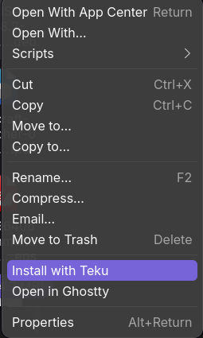
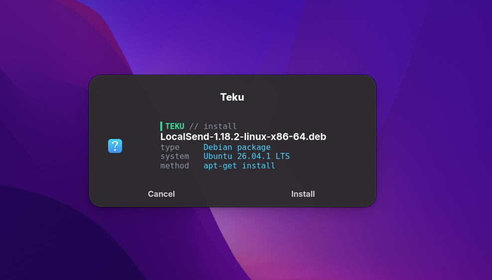
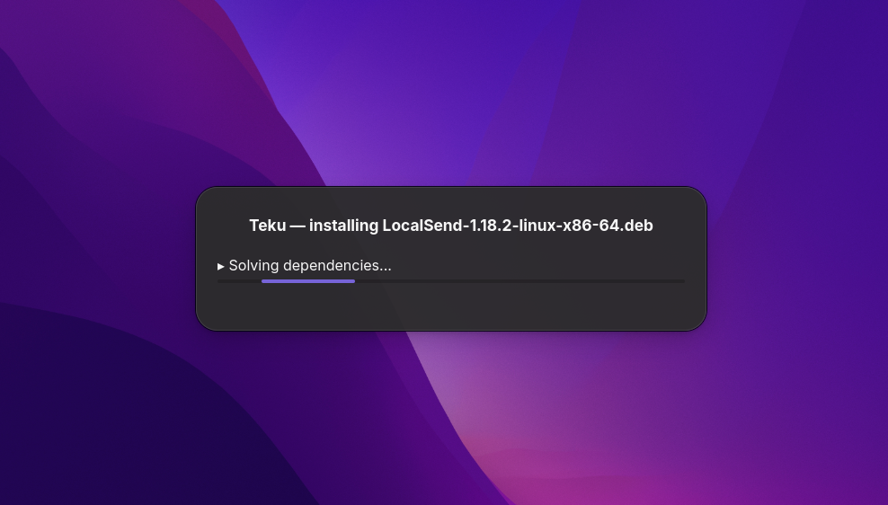
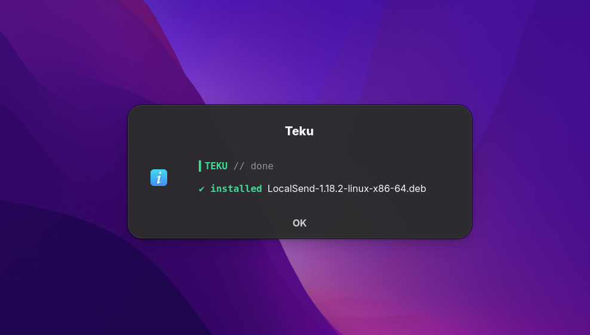

<p align="center"></p>

# Teku

Install Linux apps from a right-click. Teku looks at the file and your distro,
then installs it — or tells you plainly why it can't.

| File | Works on | What Teku does |
|---|---|---|
| `.deb` | Debian, Ubuntu, Mint, Pop!_OS | `pkexec apt-get install` |
| `.rpm` | Fedora / RHEL, openSUSE | `pkexec dnf install` / `pkexec zypper install` |
| `.AppImage` | any | moves it to `~/Applications`, makes it executable, adds a menu entry + icon |
| `.flatpakref` | any distro with Flatpak | `flatpak install --from` |
| `.exe` `.msi` / `.dmg` `.pkg` | — | explains it's a Windows / macOS app |

File types are detected from the file's contents (`file` plus magic bytes), so
a renamed file can't fool Teku. The distro comes from `/etc/os-release`
(`ID` and `ID_LIKE`).

The only UI is small dark popups: confirm → progress → done / error.

## Screenshots

<table>
  <tr>
    <td align="center" rowspan="3" valign="top"><b>1. Right-click a file</b><br><br></td>
    <td align="center"><b>2. Confirm</b><br></td>
  </tr>
  <tr>
    <td align="center"><b>3. Installing</b><br></td>
  </tr>
  <tr>
    <td align="center"><b>4. Done</b><br></td>
  </tr>
</table>

## Install

Teku comes in three formats. Pick the one for your distro:

| Your distro | Download | Section |
|---|---|---|
| Ubuntu, Debian, Linux Mint, Pop!_OS, Zorin, elementary, KDE Neon | `teku_0.1.1_all.deb` | [Debian / Ubuntu](#debian--ubuntu--mint--pop_os) |
| Fedora, RHEL, CentOS Stream, Rocky, Alma | `teku-0.1.1-1.fc44.noarch.rpm` | [Fedora](#fedora--rhel) |
| openSUSE Tumbleweed / Leap | `teku-0.1.1-1.fc44.noarch.rpm` | [openSUSE](#opensuse) |
| Arch, Manjaro, EndeavourOS, anything else | `Teku-0.1.1-x86_64.AppImage` | [AppImage](#appimage-any-distro) |

All files are on the [Releases page](https://github.com/anuzdhk/teku/releases/latest).
Not sure which distro you have? Run `cat /etc/os-release`.

---

### What Teku needs

The `.deb` and `.rpm` packages install all of this for you. Only the AppImage and
source installs need you to check it.

| Program | What for | Already on most desktops? |
|---|---|---|
| `bash`, `file` | the script itself, file detection | yes |
| `pkexec` (polkit) | the password prompt for system installs | yes |
| `zenity` | the popups | GNOME yes; KDE often no |
| Nautilus Python plugin | top-level **Install with Teku** in GNOME Files | no (optional) |
| `flatpak` | installing `.flatpakref` files | varies (optional) |

---

### Debian / Ubuntu / Mint / Pop!_OS

1. Download the package:

   ```bash
   cd ~/Downloads
   wget https://github.com/anuzdhk/teku/releases/download/v0.1.1/teku_0.1.1_all.deb
   ```

2. Install it. Keep the `./`, because without it apt looks for a package
   called `teku_0.1.1_all.deb` in its repositories:

   ```bash
   sudo apt install ./teku_0.1.1_all.deb
   ```

   apt also pulls in `zenity`, `python3-nautilus` and `flatpak` if they're missing.

3. Restart your file manager (GNOME Files / Nautilus):

   ```bash
   nautilus -q
   ```

Done. Jump to [Check it works](#check-it-works).

---

### Fedora / RHEL

1. Download and install:

   ```bash
   cd ~/Downloads
   wget https://github.com/anuzdhk/teku/releases/download/v0.1.1/teku-0.1.1-1.fc44.noarch.rpm
   sudo dnf install ./teku-0.1.1-1.fc44.noarch.rpm
   ```

   dnf also installs `zenity`, `nautilus-python` and `flatpak` if they're missing.

2. Restart Nautilus:

   ```bash
   nautilus -q
   ```

---

### openSUSE

The RPM isn't signed, so zypper needs `--allow-unsigned-rpm`:

```bash
cd ~/Downloads
wget https://github.com/anuzdhk/teku/releases/download/v0.1.1/teku-0.1.1-1.fc44.noarch.rpm
sudo zypper install --allow-unsigned-rpm ./teku-0.1.1-1.fc44.noarch.rpm
nautilus -q
```

The `fc44` in the name is only the build tag. The package is `noarch` and works on openSUSE.

---

### AppImage (any distro)

The AppImage holds Teku itself but uses your system's `zenity`, `pkexec` and
`file`. It doesn't need the old `libfuse2` library. If it won't start, run it once
with `--appimage-extract-and-run`.

1. Install `zenity` if you don't have it (`which zenity` prints nothing when it's missing):

   | Distro | Command |
   |---|---|
   | Arch / Manjaro | `sudo pacman -S zenity` |
   | Debian / Ubuntu | `sudo apt install zenity` |
   | Fedora | `sudo dnf install zenity` |
   | openSUSE | `sudo zypper install zenity` |

2. Download it, put it somewhere permanent, and make it executable:

   ```bash
   mkdir -p ~/Applications
   cd ~/Applications
   wget https://github.com/anuzdhk/teku/releases/download/v0.1.1/Teku-0.1.1-x86_64.AppImage
   chmod +x Teku-0.1.1-x86_64.AppImage
   ```

   The menu entries point to this exact path, so if you move or rename the file
   later, open it again to update them.

3. Open it once, by double-clicking it or running `./Teku-0.1.1-x86_64.AppImage`.
   Teku asks **Add Teku to your right-click menu?** Choose **Add**.

4. GNOME Files only: for the top-level menu entry, install the Nautilus Python
   plugin, then restart Nautilus:

   | Distro | Package |
   |---|---|
   | Arch / Manjaro | `python-nautilus` |
   | Debian / Ubuntu | `python3-nautilus` |
   | Fedora | `nautilus-python` |

   ```bash
   nautilus -q
   ```

   Without the plugin, Teku is still under right-click → **Scripts** and **Open With**.

---

### From source

For developers, or distros not covered above. Needs `git` and `make`.

```bash
git clone https://github.com/anuzdhk/teku.git
cd teku
sudo make install          # system-wide, into /usr
```

No root? `make install-user` installs into `~/.local` instead.

---

### Check it works

```bash
teku --version
```

should print `teku 0.1.1` (skip this for the AppImage). Then right-click any
`.deb`, `.rpm`, `.AppImage` or `.flatpakref` file:

| File manager | Where to find Teku |
|---|---|
| GNOME Files (Nautilus) | **Install with Teku** in the menu (needs the Python plugin), or **Scripts → Install with Teku** |
| Dolphin (KDE Plasma) | **Install with Teku** in the menu (AppImage: **Open With**) |
| Nemo (Cinnamon / Mint) | **Install with Teku** in the menu (AppImage: **Open With**) |
| Any other | **Open With → Install with Teku** |

You can also run it on a file from a terminal: `teku ~/Downloads/some-app.deb`.

---

### Updating

Download the new version and install it the same way. apt, dnf and zypper replace
the old version. For the AppImage, delete the old file, then open the new one once
so the menu entries point at it.

---

### Uninstalling

| Installed with | Remove with |
|---|---|
| `.deb` | `sudo apt remove teku` |
| `.rpm` (Fedora) | `sudo dnf remove teku` |
| `.rpm` (openSUSE) | `sudo zypper remove teku` |
| `sudo make install` | `sudo make uninstall` (in the source folder) |
| `make install-user` | `make uninstall-user` |

AppImage: delete the AppImage file, then remove the menu entries it added:

```bash
rm -f ~/.local/share/applications/teku.desktop \
      ~/.local/share/icons/hicolor/512x512/apps/teku.png \
      ~/.local/share/nautilus-python/extensions/teku_nautilus.py \
      "$HOME/.local/share/nautilus/scripts/Install with Teku"
```

Uninstalling Teku doesn't touch apps you installed with it.

---

### Troubleshooting

**"Install with Teku" isn't in the right-click menu**
- Run `nautilus -q`, or log out and back in.
- GNOME Files: check the Python plugin is installed (see the tables above). Without
  it, look under **Scripts** or **Open With**.
- Dolphin / Nemo with the AppImage: use **Open With**. Their menu entries come with
  the `.deb` / `.rpm`.

**`E: Unsupported file ./teku_0.1.1_all.deb given on commandline`**
You're not in the folder that holds the file. `cd ~/Downloads` first, or give the full path.

**`sudo: Authentication failed`**
Type your own login password. Nothing shows while you type.

**Nothing happens when I click Install with Teku**
Run Teku from a terminal to see what's wrong:

```bash
teku ~/Downloads/some-app.deb
```

If it prints text instead of showing popups, `zenity` is missing or there's no display.

**The password prompt never appears**
Teku uses `pkexec`, which needs your desktop's polkit agent. GNOME, KDE, Cinnamon and
Xfce include one. Minimal window managers (i3, sway) need one started, for example
`polkit-gnome` or `lxpolkit`.

**An install failed**
Click **Show log** in the error popup, or open `~/.local/state/teku/last.log`.
Every attempt is listed in `~/.local/state/teku/history.log`.

## Use

Right-click an app file → **Install with Teku** (see [Check it works](#check-it-works)
for where it shows up in each file manager).

From a terminal:

```
teku FILE...                     install
teku --uninstall-appimage [FILE] remove an AppImage Teku installed
teku --detect FILE...            show what Teku sees, install nothing
teku -y FILE                     skip the confirm popup
TEKU_NO_GUI=1 teku FILE          terminal output only
```

Logs: `~/.local/state/teku/last.log` (last install) and `history.log` (every attempt).

## Layout

```
teku                    entry point
lib/detect.sh           file type + OS detection, routing rules
lib/ui.sh               zenity popups (dark, terminal style) + terminal fallback
lib/install_*.sh        one installer per format
lib/host.sh             runs host commands via flatpak-spawn inside Flatpak
data/                   desktop entry, icon, file-manager integrations
packaging/              .deb, .rpm and AppImage builders, Flathub + Snap drafts
.github/workflows/      release build: tag vX.Y.Z to publish all three
tests/run.sh            detection and AppImage tests
```

## Distribution

1. **Primary:** `.deb` on GitHub Releases.
2. **Flathub:** `packaging/flatpak/` — runs installs through `flatpak-spawn --host`,
   which needs `--talk-name=org.freedesktop.Flatpak`. Reviewers will look hard at
   that; the submission must explain that installing host packages is the app's purpose.
3. **Snap Store:** `packaging/snap/` — needs classic confinement, which is reviewed by
   hand and often refused for installers.

The Flatpak and Snap manifests are untested drafts.

## License

MIT
